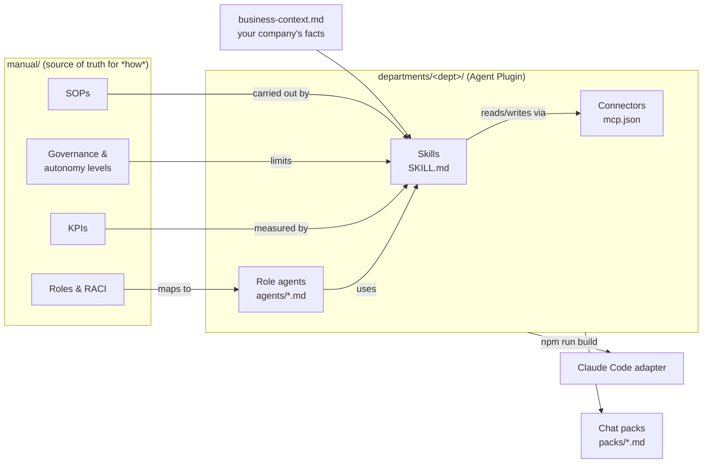

# Architecture

## The idea in one picture

- **The manual** says *how the business works*: who owns what, the steps, the approval points and the measures.
- **The business context file** says *what this particular business is*: offer, customers, pricing rules, tone, tools and approval limits.
- **Skills** carry out one SOP (or one clear part of it), reading both.
- **Role agents** match the roles in the RACI and coordinate the skills that role owns.
- **Connectors** (MCP servers) let skills read and write real systems. They're optional.

## Formats and why

| Piece | Format | Standard |
|---|---|---|
| Skill | `skills/<name>/SKILL.md`, YAML frontmatter (`name`, `description`, `metadata`) + Markdown | [Agent Skills](https://agentskills.io) |
| Plugin manifest | `plugin.json` at the plugin root | [Agent Plugins 1.0](https://agent-plugins.org) |
| Connectors | `mcp.example.json` at the plugin root. Copy the servers you use into `mcp.json`. None ship switched on, because the tools are each business's choice | Agent Plugins 1.0 / [MCP](https://modelcontextprotocol.io) |
| Role agent | `agents/<role>.md`, YAML frontmatter (`name`, `description`, `skills`) + Markdown | Claude Code subagent format. Not part of Agent Plugins 1.0, and readable as plain instructions anywhere |
| SOP | `manual/<dept>/sops/<ID>-<slug>.md`, YAML frontmatter + Markdown | This repo ([schema](../schemas/sop.schema.json)) |
| KPI | `manual/<dept>/kpis.yaml` | This repo ([schema](../schemas/kpi.schema.json)) |
| Roles | `manual/00-company-foundations/roles.yaml` | This repo ([schema](../schemas/roles.schema.json)) |

Agent Skills and Agent Plugins are open standards supported by most agent tools, so the source files are written once in those formats. `npm run build` then produces what each tool expects:

| Output | Path | For |
|---|---|---|
| Claude Code plugin manifest | `departments/<dept>/.claude-plugin/plugin.json` | Claude Code |
| Marketplace | `.claude-plugin/marketplace.json` | `claude plugin marketplace add` |
| Skill references | `departments/<dept>/skills/<skill>/references/` | Every tool: the SOP and governance text bundled with each skill, so a skill installed on its own still has its procedure |
| Chat packs | `packs/<dept>/<role>/INSTRUCTIONS.md` + `KNOWLEDGE.md` | Claude Projects, custom GPTs, Copilot agents: instructions under 8,000 characters, plus a knowledge file with the skills and full SOPs |
| Roles directory | `manual/00-company-foundations/roles-directory.md` | People reading the manual |
| KPI tables | `manual/<dept>/kpis.md` | People reading the manual |

## Traceability rules (enforced by `npm run validate`)

- Every skill's `metadata.sop` points to an existing SOP, and that SOP lists the skill.
- Every SOP's RACI roles exist in `roles.yaml`, and each SOP has exactly one accountable role.
- Every autonomy level in an SOP's step table is at or below the SOP's `max_autonomy`, and the skill's `metadata.autonomy` is at or below it too.
- Every KPI an SOP references exists.
- Every skill an agent lists exists in that plugin.
- Relative links in Markdown resolve.

## Vertical overlays (planned)

`verticals/<industry>/` will hold an `overlay.yaml` that declares which department SOPs it extends or replaces, plus its own SOPs, KPIs and skills (for example `verticals/healthcare/` adds HIPAA handling to the HR and IT SOPs). A department plugin stays usable without any overlay.
