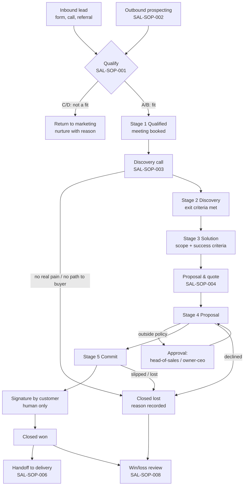
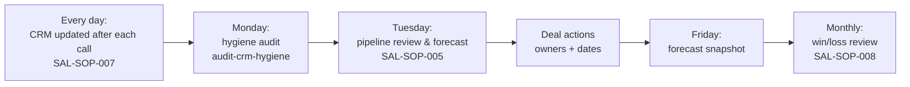

# Sales workflows

## Lead to cash (end to end)

## Weekly rhythm

| When | What | SOP | Skill |
|---|---|---|---|
| Within 1 hour of a lead arriving (business hours) | Qualify and respond | SAL-SOP-001 | `qualify-lead` |
| Daily | Outbound research and drafted outreach | SAL-SOP-002 | `research-prospect`, `draft-outreach` |
| Before every discovery call | Call plan | SAL-SOP-003 | `prep-discovery-call` |
| Within 24 hours after every sales call | Summary, CRM update, follow-up email | SAL-SOP-003 | `summarize-sales-call` |
| Monday | Hygiene audit, fixes assigned to owners | SAL-SOP-007 | `audit-crm-hygiene` |
| Weekly pipeline meeting | Pipeline review, forecast call | SAL-SOP-005 | `review-pipeline` |
| Within 1 business day of signature | Handoff package | SAL-SOP-006 | `handoff-closed-deal` |
| Monthly | Win/loss themes | SAL-SOP-008 | `analyze-win-loss` |

## Where humans must act

These points are never delegated to an agent, whatever the autonomy settings say (see [hard stops](../00-company-foundations/governance-and-autonomy.md#hard-stops)):

- approving any discount, credit or term outside policy,
- sending a contract for signature and signing anything,
- committing delivery dates or scope that delivery hasn't confirmed,
- first outreach to a prospect's executive team, unless the business has approved the template and the list.
